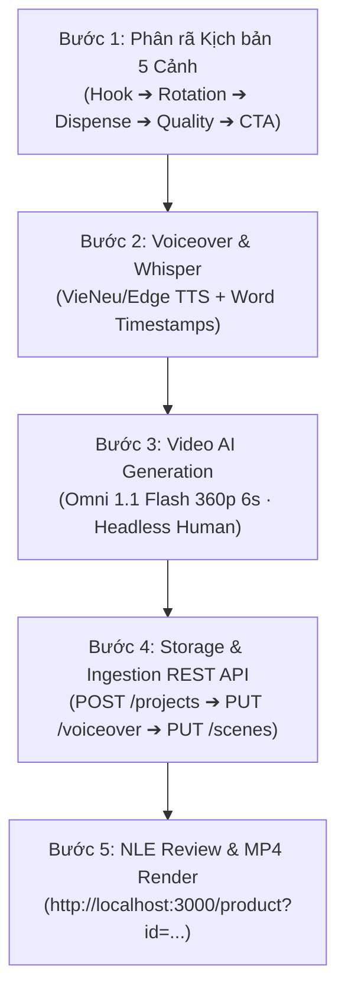

# 🌾 AI Product TVC Workflow (Quy Trình Chuẩn Sản Xuất Video Sản Phẩm)

Quy trình này áp dụng cho mọi yêu cầu làm video giới thiệu / quảng cáo sản phẩm bằng AI.
**Nguyên tắc cốt lõi**:
1. **API-Driven 100%**: Tuyệt đối **KHÔNG** sửa mã nguồn frontend (`page.tsx`) để thêm dự án. Luôn khởi tạo và lưu trữ phân cảnh thông qua Backend REST API của Go (`http://localhost:9090/api/v1`).
2. **Quy Tắc Quản Lý GFlow Project (Tránh Tạo Project Rác)**:
   - Trước khi sinh ảnh hoặc video, **luôn tạo 1 Flow Project duy nhất** đại diện cho chiến dịch:
     `gflow project create --title "Tên Chiến Dịch / Sản Phẩm"`
   - Sau đó truyền cờ `--project <GFLOW_PROJECT_ID>` (hoặc set `export GFLOW_CLI_PROJECT=<ID>`) vào **TẤT CẢ** các lệnh `gflow image` và `gflow video`.
   - **Tuyệt đối không chạy gflow trần** không có cờ `--project` vì Google Flow sẽ tự động tạo một project mới cho mỗi prompt làm rác dashboard.
3. **Headless Human Framing**: Để video chân thực nhưng không bị lỗi biến dạng mặt AI, luôn yêu cầu góc máy cắt từ ngực trở xuống (*neck-down / chest-down, no head or face visible*), tương tác thật với sản phẩm.
4. **Second-by-Second Prompting**: Prompt video phải phân rã hành động theo mốc giây cụ thể (0-2.5s, 2.5-5.0s, 5.0-6.0s).
5. **Smart Auto-Fit Speed**: Luôn gắn `#crop=50,50,1,0&v=1&autofit=1&srcdur=6.04` để Remotion tự động co giãn tốc độ phát (`playbackRate = usableSourceDuration / sceneDuration`) vừa khít câu thoại.

---

## 5 Bước Vận Hành Chuẩn



---

### Bước 1: Cấu Trúc Kịch Bản 5 Phân Cảnh (25s - 30s)
1. **Cảnh 1 (Hook & Pain Point · ~6-7s)**: Chỉ ra nỗi đau của người dùng (bếp bừa bộn túi nilon, đồ đạc ẩm mốc, vướng víu) ➔ Pan máy hé lộ giải pháp sang trọng.
2. **Cảnh 2 (Hero Feature & 360° View · ~5-6s)**: Điểm nhấn thiết kế độc đáo (thân xoay 360 độ, các ngăn chia màu sắc, vật liệu tinh tế).
3. **Cảnh 3 (Action Demo / Interactive · ~4-5s)**: Trải nghiệm thao tác (1 nút bấm tự đong, khay thoát nước, đóng mở tiện lợi).
4. **Cảnh 4 (Quality & Reliability · ~3-4s)**: Chứng minh chất liệu & độ bền (nhựa PP thực phẩm, ngăn tỏi chống mọt, nắp gioăng kín khít).
5. **Cảnh 5 (Lifestyle & CTA · ~3-4s)**: Toàn cảnh không gian sống ấm cúng, sản phẩm bên thành phẩm (bát cơm nóng, tách cà phê) kèm lời kêu gọi bấm giỏ hàng chốt đơn.

---

### Bước 2: Sinh Giọng Đọc & Trích Xuất Mốc Thời Gian Từng Từ (Whisper)
- **Giọng đọc**: Ưu tiên VieNeu-TTS local hoặc Edge-TTS (Duyên Hà My / Hoài My, tốc độ 1.15x cho nhịp điệu thương mại).
- **Phụ đề**: Chạy Whisper trích xuất `words`:
  ```json
  [
    { "text": "Bếp", "startMs": 0, "endMs": 280 },
    { "text": "bừa", "startMs": 280, "endMs": 420 },
    ...
  ]
  ```
- Lưu file âm thanh tại: `storage/{project_id}/voice.wav`.

---

### Bước 3: Sinh Video AI (Omni 1.1 Flash · Headless Human)
- **Thiết lập chuẩn**:
  - Model: `Omni 1.1 Flash` (`--model omni-flash`)
  - Resolution: `360p` (9:16 portrait: `360x640`)
  - Duration: `6s` (`--duration 6`)
  - Cost: `5 credits / generation`
- **Quy tắc Prompt**:
  - Mở đầu bằng phong cách: `Cinematic commercial shot, modern sunlit kitchen, softbox lighting, 9:16 vertical`.
  - Giới hạn người mẫu: `A person in neutral clothing, neck down framing, head and face out of frame`.
  - Phân chia giây:
    - *Giây 0 - 2.5*: Bắt đầu hành động (tay tiếp cận, nhấc túi, xoay thân).
    - *Giây 2.5 - 5.0*: Hành động chính (ấn nút, hạt rơi, đậy nắp).
    - *Giây 5.0 - 6.0*: Giữ khung hình ổn định hoặc lia máy kết cảnh.

---

### Bước 4: Lưu Trữ & Nạp Dự Án Qua REST API (100% Dynamic)

#### 4.1. Đảm bảo Storage Symlink
Kiểm tra liên kết giữa `storage/` và `apps/web/public/` để media server (Go API :9090) phục vụ video HTTP 200:
```bash
# Ví dụ tạo symlink cho thư mục sản phẩm mới:
ln -s "/path/to/rac-vl/apps/web/public/product-xyz" "/path/to/rac-vl/storage/product-xyz"
```

#### 4.2. Khởi tạo dự án
```bash
curl -X POST "http://localhost:9090/api/v1/projects" \
  -H "Content-Type: application/json" \
  -d '{
    "title": "🌾 TVC Hộp Đựng Hạt Pinewoods (25s)",
    "script": "Bếp bừa bộn cả chục túi nilon...",
    "aspectRatio": "9:16",
    "videoType": "product"
  }'
# Trả về: { "code": "00", "data": { "id": "project_uuid" } }
```

#### 4.3. Cập nhật Audio & Phụ đề qua REST API (`PUT /projects/:id/voiceover`)
Gọi endpoint `PUT http://localhost:9090/api/v1/projects/{project_id}/voiceover` (hoặc `PATCH`):
```bash
curl -X PUT "http://localhost:9090/api/v1/projects/{project_id}/voiceover" \
  -H "Content-Type: application/json" \
  -d '{
    "audioUrl": "http://localhost:9090/media/{project_id}/voice.wav",
    "durationMs": 40887,
    "status": "ready",
    "words": [
      { "text": "Bạn", "startMs": 0, "endMs": 220 },
      { "text": "có", "startMs": 220, "endMs": 380 }
    ]
  }'
```

#### 4.4. Lưu 5 Phân cảnh kèm URL Auto-fit
Gọi `PUT http://localhost:9090/api/v1/projects/{project_id}/scenes`:
```json
{
  "scenes": [
    {
      "sceneIndex": 1,
      "startMs": 0,
      "endMs": 6880,
      "transcriptText": "Bếp bừa bộn cả chục túi nilon...",
      "setting": "[1. HOOK] • Bếp lộn xộn -> Pan sang thùng Pinewoods",
      "imageUrl": "http://localhost:9090/media/product-xyz/clips/scene_01.mp4#crop=50,50,1,0&v=1&autofit=1&srcdur=6.04",
      "cameraEffect": "zoom_in",
      "transition": "fade",
      "showCaption": true,
      "calloutTag": "Giải Pháp",
      "calloutText": "Gọn gàng sạch đẹp",
      "calloutPosition": "top_center",
      "calloutTheme": "dark"
    }
    // ... Cảnh 2 -> 5
  ]
}
```

---

### Bước 5: Kiểm Tra & Render MP4 Hoàn Chỉnh
1. Mở xem trực tiếp: `http://localhost:3000/product?id={project_id}`.
2. Dự án tự động hiển thị trong dropdown **"Dự án của bạn"**.
3. Tiến hành kiểm tra âm thanh, phụ đề highlight từng từ và chuyển cảnh.
4. Render MP4: Gọi API `POST http://localhost:8000/video/render` hoặc bấm nút **"Render Video MP4"** trên giao diện Studio.
